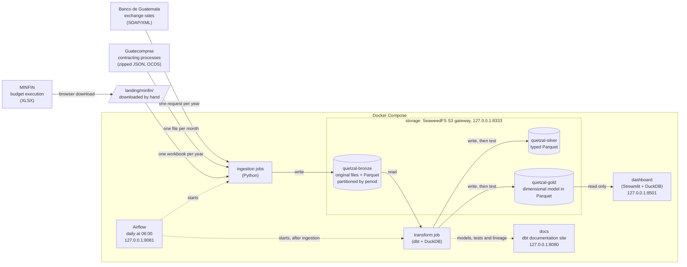

# quetzal-lakehouse

A lakehouse on public financial data from Guatemala: the central bank's
exchange rate, public procurement and the central government's budget. Each
source lands untouched in bronze, dbt and DuckDB turn it into typed silver
tables and a star schema in gold, Airflow runs it every day, and a dashboard
reads gold.

Everything described here exists in the repository. Planned work is listed
under [Status](#status).

## What it answers

- How much the government awards each year, under which procedures and to
  whom, in quetzales and in dollars at the exchange rate of each day.
- How much of its budget each central government entity has spent, next to
  what it awarded through public procurement.
- How the quetzal has moved against the dollar since 1989.

## Highlights

- **Three sources, three shapes:** a SOAP/XML web service, about 0.7 GB of
  zipped JSON in the Open Contracting Data Standard on every refresh, and
  Excel workbooks behind a bot challenge, which are downloaded by hand rather
  than worked around.
- **Idempotent ingestion:** each job replaces whole periods (a year, a month)
  under fixed names, so a rerun never duplicates data, and months the source
  has not changed are skipped by their checksum.
- **Storage apart from compute:** every layer is Parquet in its own bucket of
  an S3-compatible store; DuckDB is only the engine, so moving to AWS S3
  changes configuration, not code.
- **A dimensional model:** three fact tables (513,471 awards, 329,256 budget
  lines, a daily exchange rate) sharing date, currency and entity dimensions,
  so budget and procurement can be compared entity by entity.
- **Tests that encode what profiling found:** 195 dbt data tests and 8 unit
  tests fail on new anomalies, not on the known ones; 67 ingestion tests and
  13 dashboard tests cover the Python code.
- **Governance:** natural persons are pseudonymized in gold with a keyed hash,
  each job has a storage key pair that reaches only its own buckets, dbt runs
  in separate dev and prod environments, and the lineage runs from each source
  to the dashboard.
- **Runs on its own:** Airflow runs the whole pipeline every day at 06:00,
  Guatemala time.

Row counts are from the run of 2026-10-13.

## Architecture



## Stack

| Part | Tools |
|---|---|
| Object storage | SeaweedFS behind the S3 API |
| Ingestion | Python 3.13, httpx, pyarrow, uv |
| Transformation | dbt Core 1.12 with dbt-duckdb, DuckDB 1.5 |
| Orchestration | Airflow 3.3 with the local executor and Postgres |
| Dashboard | Streamlit with DuckDB |
| Runtime | Docker Compose |

## Repository layout

| Path | What it holds |
|---|---|
| `ingestion/` | The jobs that land each source in bronze, as one Python package with its tests. |
| `transform/` | The dbt project: silver and gold models, tests, seeds and the pseudonymization plugin. |
| `orchestration/dags/` | The Airflow DAG. |
| `dashboard/` | The Streamlit dashboard, its queries and their tests. |
| `docs/` | The documentation listed below. |
| `docker-compose.yml` | Every service and job, with the storage roles. |
| `.env.example` | The configuration to copy into a local `.env`, which git ignores. |

## Quick start

Requirements: Docker with Compose v2, and about 2 GB of disk. A first full
load takes about fifteen minutes.

```bash
cp .env.example .env                    # then replace the placeholder values
docker compose up -d --wait             # object store
docker compose run --rm ingestion exchange-rates --from-year 1989
docker compose run --rm ingestion contracting-processes --from-month 2025-01
docker compose run --rm ingestion budget-execution    # workbooks in landing/minfin/
docker compose run --rm transform       # dbt build: silver, gold and tests
docker compose up -d dashboard          # http://localhost:8501
```

The budget workbooks have to be downloaded by hand first;
[Getting started](docs/getting-started.md) says where from, and covers the
documentation site, Airflow and development.

## Documentation

| Document | What it covers |
|---|---|
| [Getting started](docs/getting-started.md) | Every step to run the project, the dbt documentation site, Airflow, and development. |
| [Data model](docs/data-model.md) | The bronze, silver and gold layouts, the star schema with example queries, and the dashboard. |
| [Data quality](docs/data-quality.md) | What profiling each source found, and the tests that encode it. |
| [Governance](docs/governance.md) | Personal data and its masking, the storage roles, the two environments, and lineage. |
| [Design decisions](docs/design-decisions.md) | Each decision, with the alternatives that were rejected. |
| [Known limitations](docs/known-limitations.md) | What the project does not handle, or handles only in part. |

## Status

Built, in this order: the choice of sources, the storage, the bronze, silver
and gold layers for the exchange rate, procurement and the budget, the daily
orchestration, governance, and the dashboard.

Not built yet:

1. Deployment to AWS with Terraform.

Also not built: publishing the dbt documentation (for example on GitHub
Pages) and a table format for silver and gold.

## Data sources

- Exchange rates: [Banco de Guatemala](https://www.banguat.gob.gt/), web
  service `TipoCambio`.
- Contracting processes: [Guatecompras](https://ocds.guatecompras.gt/),
  Ministerio de Finanzas Públicas, published in the Open Contracting Data
  Standard under the
  [Creative Commons Attribution 4.0](https://creativecommons.org/licenses/by/4.0/)
  license.
- Budget execution: [Ministerio de Finanzas Públicas](https://datos.minfin.gob.gt/),
  datasets "Ejecución Presupuestaria". The 2025 dataset is published under the
  Creative Commons Attribution license; the 2026 dataset does not state a
  license yet.
