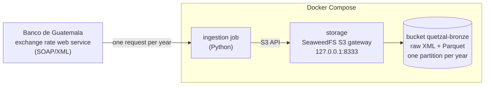

# quetzal-lakehouse

A financial lakehouse built on public data from Guatemala, organized in bronze,
silver and gold layers.

The project is built in small phases. This README describes only what exists
in the repository today; everything else is listed under
[Not built yet](#not-built-yet).

## Current state

- A Docker Compose stack with an S3-compatible object store and one bucket,
  `quetzal-bronze`.
- An ingestion job that lands the Banco de Guatemala exchange rate (quetzales
  per US dollar, one record per calendar day since November 1989) in the
  bronze bucket.

There is no transformation or data model yet.

## Architecture



## Getting started

Requirements: Docker with Compose v2.

1. Create your local configuration and replace the placeholder values:

   ```bash
   cp .env.example .env
   ```

2. Start the object store and wait until it is healthy:

   ```bash
   docker compose up -d --wait
   ```

3. Load the full exchange rate history:

   ```bash
   docker compose run --rm ingestion --from-year 1989
   ```

   The first run builds the job image. The load itself takes about ten
   seconds and logs one line per year with the number of records it stored.

4. List the partitions that were written:

   ```bash
   docker compose exec storage sh -c "echo 'fs.ls /buckets/quetzal-bronze/banguat/exchange_rates/parquet/' | weed shell"
   ```

After the first load, running the job without arguments refreshes the current
year only:

```bash
docker compose run --rm ingestion
```

Running any of these commands again replaces the same objects. Nothing is
duplicated.

The S3 endpoint is `http://localhost:8333`. Requests must be signed with the
key pair from `.env`; unsigned requests and wrong keys are rejected.

To stop the stack and keep the data:

```bash
docker compose down
```

Adding `-v` also deletes the volume, and with it every stored object.

## Bronze layout

Each year of the source is stored twice under `banguat/exchange_rates/`:

| Object | Content |
|---|---|
| `raw/year=YYYY/response.xml` | The response of the web service, byte for byte. |
| `parquet/year=YYYY/exchange_rates.parquet` | The same records in columnar form. |

The Parquet files keep the field names of the source and every value as text:

| Column | Example | Meaning |
|---|---|---|
| `moneda` | `2` | Currency code used by the source (2 is the US dollar). |
| `fecha` | `13/10/2026` | Date of the rate, as `dd/mm/yyyy`. |
| `venta` | `7.63381` | Selling rate. |
| `compra` | `7.63381` | Buying rate. |
| `_source_file` | `banguat/exchange_rates/raw/year=2026/response.xml` | Raw object the row was read from. |
| `_ingested_at` | `2026-10-13 23:31:08+00` | When the job that wrote the row started (UTC). |

## Development

The ingestion code lives in `ingestion/` and uses [uv](https://docs.astral.sh/uv/).

```bash
cd ingestion
uv run pytest
```

To run the job outside Docker against the local store:

```bash
cd ingestion
uv run --env-file ../.env python -m quetzal_ingestion.exchange_rates
```

## Design decisions

### Storage

**Object storage behind the S3 API instead of a local folder.** A folder would
be simpler, but every reader and writer would then depend on file paths.
Talking to an S3 endpoint from the start means that moving to AWS S3 changes
configuration (endpoint and credentials), not code.

**SeaweedFS instead of MinIO.** MinIO was the original choice. When this stack
was written (October 2026) the MinIO community repository was archived and its
official images could no longer be pulled from Docker Hub, so a compose file
based on them would not start. SeaweedFS is Apache-2.0 licensed, actively
maintained, and runs as a single container. Two alternatives were rejected:
RustFS, because its first stable release was less than a month old, and a
community fork of MinIO, because it is a third-party build of code its
original authors abandoned.

**One bucket per layer.** Each layer gets its own bucket rather than a prefix
inside a shared one, so access rules and retention can differ per layer: for
example, ingestion may only write to bronze and a dashboard may only read from
gold. Only the bronze bucket exists so far; the others are created when their
layers are built.

**Pinned image tag.** The image starts several components with defaults that
may change between releases. Pinning `4.48` keeps `docker compose up`
reproducible.

**Port published on loopback only.** The S3 port is bound to `127.0.0.1`, so
the store is reachable from the development machine and not from the network.

**Project-specific variable names in `.env`.** The store's key pair is read
from `S3_ACCESS_KEY_ID` and `S3_SECRET_ACCESS_KEY`, not from the standard
`AWS_*` names. Compose gives shell variables priority over `.env`, so reusing
the standard names could silently pass real AWS credentials from a developer's
shell into the local container.

### Ingestion

**A calendar year is the unit of work.** The job requests one whole year,
stores it under one partition with fixed object names, and replaces that
partition on every run. Because what is fetched, what is stored and what is
overwritten are the same thing, running the job twice cannot duplicate data
and needs no record of previous runs. The alternative, loading only the days
added since the last run, was rejected: it needs stored state and appends
rows, which is exactly what produces duplicates when a run is retried.

**Partitioned by the year of the rate.** The source has one record per day, so
daily or monthly partitions would create thousands or hundreds of files with a
handful of rows each. Yearly partitions give 38 files of about 365 rows.
Partitioning by ingestion date was also rejected: it keeps every version the
source ever returned, but the same rate date would appear in many partitions
and every reader would have to deduplicate.

**Raw response and Parquet copy side by side.** The XML is what the source
actually sent, so the Parquet files can be rebuilt if the parser turns out to
be wrong, without calling the source again. The Parquet copy exists because
DuckDB and dbt read it directly and do not read XML.

**Bronze stores text, not types.** Dates and numbers are kept as the source
wrote them. Converting them is a transformation that can fail, and failures
belong in the silver layer, where they are tested and visible.

**Responses are checked before anything is overwritten.** A response is
rejected if it is not valid XML, if the number of records does not match the
count the service declares, if it is empty, or if it contains dates from
another year. A rejected response leaves the stored partition untouched, so an
outage at the source cannot erase data that was already loaded.

**Retries are left to whoever runs the job.** Only connection failures are
retried in-process. Any other error stops the run with a non-zero exit code.
Since re-running is always safe, retry policy can live in the scheduler
instead of being reimplemented inside each job.

**Hand-written SOAP request.** The request is a ten-line XML template. A SOAP
library such as zeep would add a large dependency to generate the same text.

**Locked dependencies, fixed runtime.** `uv.lock` records the exact version
of every dependency. The job image installs from it using a fixed Python
minor version and a pinned uv version, so it does not depend on what is
installed on the machine that builds it.

## Known limitations

- The store runs as a single node without replication. It is a local
  development stand-in for S3, not a production deployment.
- The image also starts components this project does not use (a filer UI, an
  admin UI, an Iceberg REST catalog). Their ports are not published to the
  host.
- Only the US dollar is ingested.
- Overwriting a partition discards what it held before. If the source revises
  a past rate, the previous value is not kept.
- The two objects of a year are written one after the other, not atomically.
  A failure between them leaves the raw response newer than the Parquet file
  until the job runs again.
- The source returns a record for every calendar day and repeats the last
  published rate on days without a new one, such as weekends. Bronze keeps
  those rows as they come.
- Nothing schedules the job yet; it runs when someone starts it.

## Not built yet

Planned, in order:

1. Silver layer with dbt and DuckDB, including data quality tests.
2. Gold layer: a star schema and dbt-generated documentation.
3. Two more sources through all three layers.
4. Orchestration of the whole pipeline.
5. Governance: masking of sensitive data, lineage, and separate dev and prod
   environments.
6. A dashboard.
7. Deployment to AWS with Terraform.

Planned sources, checked for availability in October 2026:

- Guatecompras: public procurement in the Open Contracting Data Standard
  (monthly JSON files).
- Ministerio de Finanzas Públicas: budget execution (XLSX files and a CKAN
  API).

## Data sources

- Exchange rates: [Banco de Guatemala](https://www.banguat.gob.gt/), web
  service `TipoCambio`.
