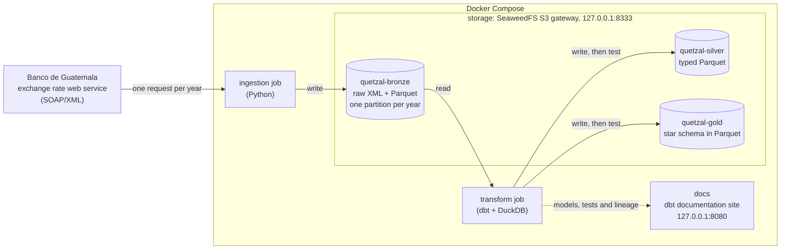
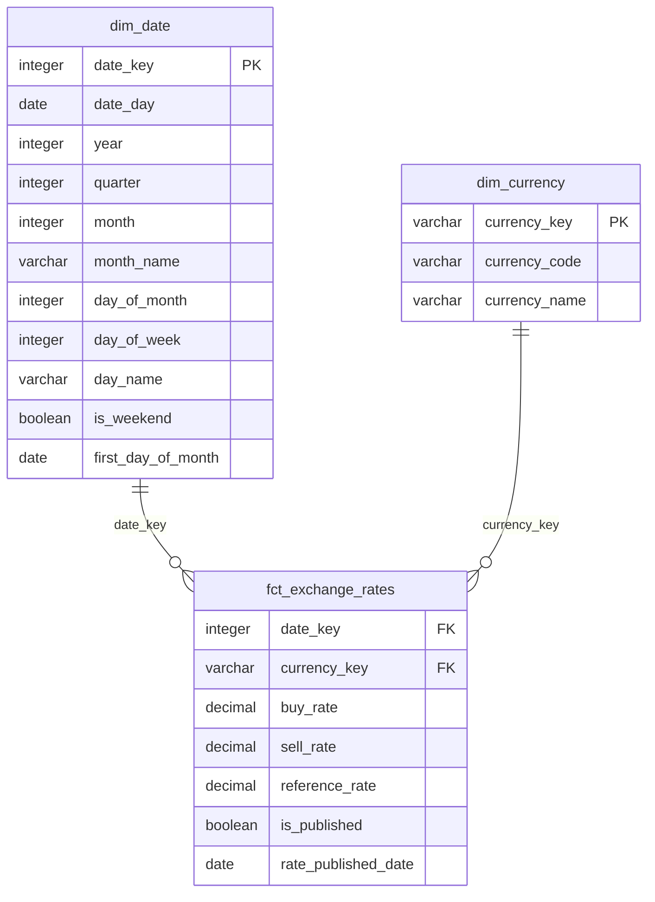

# quetzal-lakehouse

A financial lakehouse built on public data from Guatemala, organized in bronze,
silver and gold layers.

The project is built in small phases. This README describes only what exists
in the repository today; everything else is listed under
[Not built yet](#not-built-yet).

## Current state

- A Docker Compose stack with an S3-compatible object store and one bucket per
  layer: `quetzal-bronze`, `quetzal-silver` and `quetzal-gold`.
- An ingestion job that lands the Banco de Guatemala exchange rate (quetzales
  per US dollar, one record per published day since November 1989) in the
  bronze bucket.
- A dbt project that turns the bronze records into a typed silver table and
  then into a star schema in gold: one fact table and two dimensions. It is
  checked by 44 data tests and two unit tests.
- A documentation site generated by dbt, with the lineage from bronze to gold.

Only one source is loaded so far, so the star schema is small.

## Architecture



## Getting started

Requirements: Docker with Compose v2.

1. Create your local configuration and replace the placeholder values:

   ```bash
   cp .env.example .env
   ```

2. Start the object store and wait until it is healthy:

   ```bash
   docker compose up -d --wait
   ```

3. Load the full exchange rate history into bronze:

   ```bash
   docker compose run --rm ingestion --from-year 1989
   ```

   The first run builds the job image. The load itself takes about ten
   seconds and logs one line per year with the number of records it stored.

4. Build the silver and gold layers and run their tests:

   ```bash
   docker compose run --rm transform
   ```

   This runs `dbt build`. It should end with `PASS=52 ... ERROR=0`.

5. Open the documentation of the models, with their lineage graph, at
   <http://localhost:8080>:

   ```bash
   docker compose up -d docs
   ```

   The site describes what the last transform run built, and takes about
   half a minute to come up.

After the first load, running the ingestion job without arguments refreshes
the current year only:

```bash
docker compose run --rm ingestion
```

Running any of these commands again replaces the same objects. Nothing is
duplicated.

To check how old the bronze data is:

```bash
docker compose run --rm transform source freshness
```

The S3 endpoint is `http://localhost:8333`. Requests must be signed with the
key pair from `.env`; unsigned requests and wrong keys are rejected.

To stop the stack, including the documentation site, and keep the data:

```bash
docker compose --profile docs down
```

Adding `-v` also deletes the volumes, and with them every stored object.

## Bronze layout

Each year of the source is stored twice under `banguat/exchange_rates/`:

| Object | Content |
|---|---|
| `raw/year=YYYY/response.xml` | The response of the web service, byte for byte. |
| `parquet/year=YYYY/exchange_rates.parquet` | The same records in columnar form. |

The Parquet files keep the field names of the source and every value as text:

| Column | Example | Meaning |
|---|---|---|
| `moneda` | `2` | Currency code used by the source (2 is the US dollar). |
| `fecha` | `13/10/2026` | Date of the rate, as `dd/mm/yyyy`. |
| `venta` | `7.63381` | Selling rate. |
| `compra` | `7.63381` | Buying rate. |
| `_source_file` | `banguat/exchange_rates/raw/year=2026/response.xml` | Raw object the row was read from. |
| `_ingested_at` | `2026-10-13 23:31:08+00` | When the job that wrote the row started (UTC). |

## Silver layout

The dbt model `stg_banguat__exchange_rates` is written to
`banguat/exchange_rates/exchange_rates.parquet` in the silver bucket, as one
file with one row per published day:

| Column | Type | Meaning |
|---|---|---|
| `rate_date` | `DATE` | Calendar day the rate applies to. |
| `currency_code` | `VARCHAR` | ISO 4217 code of the currency being priced (`USD`). |
| `buy_rate` | `DECIMAL(10,6)` | Buying rate, in quetzales per unit of the currency. |
| `sell_rate` | `DECIMAL(10,6)` | Selling rate, in quetzales per unit of the currency. |
| `source_file` | `VARCHAR` | Raw object in bronze the row came from. |
| `ingested_at` | `TIMESTAMP WITH TIME ZONE` | When the ingestion run that loaded the row started. |

## Gold layout

Gold is a star schema. Each table is one Parquet file in the gold bucket,
under a folder with the table's name.



| Table | Grain | Rows |
|---|---|---|
| `fct_exchange_rates` | One row per currency and calendar day, from the first to the last published day. | 13,491 |
| `dim_date` | One row per day, from 1989-01-01 to the end of the current year. | 13,879 |
| `dim_currency` | One row per currency. | 2 |

Row counts are from 2026-10-13.

`fct_exchange_rates` has five rows more than silver: the days the source never
published. Each takes the last rate published before it and is marked with
`is_published = false`; `rate_published_date` says which day the rate comes
from. `reference_rate` is the rate to convert amounts with: the midpoint of
the buying and selling rates.

Example: the average rate per year, read through the star schema.

```sql
select
    d.year,
    c.currency_code,
    count(*) as days,
    round(avg(f.reference_rate), 5) as avg_reference_rate
from fct_exchange_rates as f
inner join dim_date as d using (date_key)
inner join dim_currency as c using (currency_key)
where d.year >= 2024
group by all
order by d.year
```

| year | currency_code | days | avg_reference_rate |
|---|---|---|---|
| 2024 | USD | 366 | 7.75960 |
| 2025 | USD | 365 | 7.67973 |
| 2026 | USD | 286 | 7.63816 |

The 2026 row runs to 2026-10-13. Any query can be run against the built
tables through dbt:

```bash
docker compose run --rm transform show --inline "select * from dim_currency"
```

## Data quality

Profiling the full history (13,486 rows, 1989-11-06 to 2026-10-13) showed
three properties of the source. Silver keeps the published values as they are
and the tests encode each property, so the build fails on anything new.

| Finding | How it is handled |
|---|---|
| Five calendar days have no record: 2000-04-02, 2000-05-01, 2001-09-02, 2004-03-06 and 2004-03-07. | They are listed in the seed `banguat_known_missing_dates`. One test fails on any other missing day; another fails if a listed day appears in the data, so the list cannot go stale. |
| On 85 days between 1989-11-16 and 1991-04-09 the selling rate is below the buying rate. | Kept as published. A test requires the selling rate to be at least the buying rate from 1992 on. |
| Buying and selling rates differ on every day up to 2006-12-01 and are equal on every day since 2006-12-02. | A test requires both rates to be equal from 2006-12-02 on. If they diverge again, the meaning of the fields has changed. |

The remaining tests check that no column is null, that `rate_date` is unique,
that the currency is `USD`, that both rates fall between 1 and 20 quetzales
(the historical range is 2.78 to 8.39), and that silver has exactly as many
rows as bronze. A unit test checks the conversion from source text to typed
values on a fixed input row.

Gold has its own tests. Keys are unique and not null, and every key in the
fact table exists in its dimension. `dim_date` has no missing days. The fact
table has exactly one row per currency and calendar day, the days it fills in
are exactly the five days listed as missing, and `reference_rate` always lies
between the buying and selling rates. A unit test feeds the fact model a gap
and checks that the skipped day takes the previous rate and is flagged.

dbt runs a model's unit tests before building it, so a logic error that a
unit test catches stops the build before the table is overwritten.

## Development

Both projects use [uv](https://docs.astral.sh/uv/).

Ingestion tests:

```bash
cd ingestion
uv run pytest
```

Running the ingestion job outside Docker against the local store:

```bash
cd ingestion
uv run --env-file ../.env python -m quetzal_ingestion.exchange_rates
```

Running dbt outside Docker (the first command downloads the dbt packages):

```bash
cd transform
uv run --env-file ../.env dbt deps
uv run --env-file ../.env dbt build
```

## Design decisions

### Storage

**Object storage behind the S3 API instead of a local folder.** A folder would
be simpler, but every reader and writer would then depend on file paths.
Talking to an S3 endpoint from the start means that moving to AWS S3 changes
configuration (endpoint and credentials), not code.

**SeaweedFS instead of MinIO.** MinIO was the original choice. When this stack
was written (October 2026) the MinIO community repository was archived and its
official images could no longer be pulled from Docker Hub, so a compose file
based on them would not start. SeaweedFS is Apache-2.0 licensed, actively
maintained, and runs as a single container. Two alternatives were rejected:
RustFS, because its first stable release was less than a month old, and a
community fork of MinIO, because it is a third-party build of code its
original authors abandoned.

**One bucket per layer.** Each layer gets its own bucket rather than a prefix
inside a shared one, so access rules and retention can differ per layer: for
example, ingestion may only write to bronze and a dashboard may only read from
gold. A bucket is created when its layer is built.

**Pinned image tag.** The image starts several components with defaults that
may change between releases. Pinning `4.48` keeps `docker compose up`
reproducible.

**Port published on loopback only.** The S3 port is bound to `127.0.0.1`, so
the store is reachable from the development machine and not from the network.

**Project-specific variable names in `.env`.** The store's key pair is read
from `S3_ACCESS_KEY_ID` and `S3_SECRET_ACCESS_KEY`, not from the standard
`AWS_*` names. Compose gives shell variables priority over `.env`, so reusing
the standard names could silently pass real AWS credentials from a developer's
shell into the local container.

### Ingestion

**A calendar year is the unit of work.** The job requests one whole year,
stores it under one partition with fixed object names, and replaces that
partition on every run. Because what is fetched, what is stored and what is
overwritten are the same thing, running the job twice cannot duplicate data
and needs no record of previous runs. The alternative, loading only the days
added since the last run, was rejected: it needs stored state and appends
rows, which is exactly what produces duplicates when a run is retried.

**Partitioned by the year of the rate.** The source has about one record per
day, so daily or monthly partitions would create thousands or hundreds of
files with a handful of rows each. Yearly partitions give 38 files of about
365 rows. Partitioning by ingestion date was also rejected: it keeps every
version the source ever returned, but the same rate date would appear in many
partitions and every reader would have to deduplicate.

**Raw response and Parquet copy side by side.** The XML is what the source
actually sent, so the Parquet files can be rebuilt if the parser turns out to
be wrong, without calling the source again. The Parquet copy exists because
DuckDB and dbt read it directly and do not read XML.

**Bronze stores text, not types.** Dates and numbers are kept as the source
wrote them. Converting them is a transformation that can fail, and failures
belong in the silver layer, where they are tested and visible.

**Responses are checked before anything is overwritten.** A response is
rejected if it is not valid XML, if the number of records does not match the
count the service declares, if it is empty, or if it contains dates from
another year. A rejected response leaves the stored partition untouched, so an
outage at the source cannot erase data that was already loaded.

**Retries are left to whoever runs the job.** Only connection failures are
retried in-process. Any other error stops the run with a non-zero exit code.
Since re-running is always safe, retry policy can live in the scheduler
instead of being reimplemented inside each job.

**Hand-written SOAP request.** The request is a ten-line XML template. A SOAP
library such as zeep would add a large dependency to generate the same text.

**Locked dependencies, fixed runtime.** `uv.lock` records the exact version
of every dependency. The job image installs from it using a fixed Python
minor version and a pinned uv version, so it does not depend on what is
installed on the machine that builds it.

### Transformation

**Silver is Parquet in its own bucket; DuckDB is only the engine.** dbt writes
each model to the silver bucket and DuckDB keeps nothing but a view over the
file. Storage stays separate from compute: any engine that reads Parquet can
use silver, and the DuckDB database file is disposable. Keeping the tables
inside a DuckDB file was rejected because the data would leave the object
store and only DuckDB could read it. A table format such as Iceberg was left
out for now: it would add a catalog before there is a single model to manage.

**Source anomalies are kept and documented, not fixed.** Silver changes types
and names, never values. Missing days are not filled in and odd rates are not
corrected, because a row the source never published is an invention. Each
known anomaly is declared next to a test that fails on any new one.

**Strict conversions.** Dates and numbers are converted with casts that raise
an error on unexpected input, so a format change at the source stops the
build instead of producing nulls that surface later.

**Uniqueness is tested, not enforced by deduplicating.** Bronze cannot hold
the same date twice by construction. If it ever does, a failing test is more
useful than a model that silently picks one row.

**Exact decimals for rates.** Rates are `DECIMAL(10,6)`, matching the six
decimals the source uses. Floating point would make the comparison between
buying and selling rates unreliable.

**Full rebuild on every run.** The model is rebuilt from all of bronze each
time. With 13 thousand rows an incremental model would add state and edge
cases to save a fraction of a second.

**dbt Core with dbt-duckdb, not dbt v2.** When this was written the DuckDB
adapter of the new Fusion engine was in beta and its bundled driver could not
load DuckDB extensions, including the one that reads S3.

**Layer folders, dbt model names.** Models live in folders named after the
lakehouse layers (`models/silver`, `models/gold`). Model names follow the dbt
conventions: `stg_<source>__<entity>` for a one-to-one cleanup of a source
table, which is what dbt calls a staging model, and `fct_` and `dim_` for
facts and dimensions.

**The DuckDB database is kept in a volume, and is still disposable.** It
holds views over the Parquet files and the seeds, nothing else. Keeping it
between runs lets separate dbt commands, and the documentation site, see what
the last build produced. Deleting it loses nothing.

### Dimensional model

**The fact table has one row per currency and calendar day.** The source
skips five days. With a row for every day, any future fact (a purchase, a
payment) finds the rate for its own date with a plain join. The alternative,
keeping only published days, was rejected because every consumer would have
to decide what to do on a day without a rate, and they could decide
differently.

**Gaps are filled in gold, not in silver.** Silver holds what the source
published. Carrying a rate over to a skipped day is a business rule, so it
lives in gold, and the rows it creates are flagged and say which day their
rate comes from.

**One reference rate for conversions.** Until 2006-12-01 the source publishes
different buying and selling rates. Gold adds `reference_rate`, their
midpoint, so that everything downstream converts with the same number. Since
2006-12-02 both rates are equal and the midpoint is the published rate; before
that it is a computed value, and the column description says so. It is
calculated with exact decimals, which needs one more decimal place than the
source uses.

**Surrogate keys.** `dim_currency` is keyed by a hash of the ISO code and
`dim_date` by the date as the integer YYYYMMDD. A hash is the same on every
rebuild, so it needs no counter, unlike sequential integers, which would have
to remember what was assigned before. The currency code alone would work as a
key today; the hash sets the convention for dimensions that will need it, such
as suppliers or public entities that change name or come from two sources.

**The calendar does not depend on the facts.** `dim_date` is generated from a
fixed start to the end of the current year instead of from the dates present
in a fact table, so every fact table can share it.

**Documentation is served locally.** `dbt docs` is exposed as a Compose
service. Publishing it would need a CI workflow that runs the whole pipeline
and is left for later.

## Known limitations

- The store runs as a single node without replication. It is a local
  development stand-in for S3, not a production deployment.
- The image also starts components this project does not use (a filer UI, an
  admin UI, an Iceberg REST catalog). Their ports are not published to the
  host.
- Only the US dollar is ingested.
- Overwriting a partition discards what it held before. If the source revises
  a past rate, the previous value is not kept.
- The two objects of a year are written one after the other, not atomically.
  A failure between them leaves the raw response newer than the Parquet file
  until the job runs again.
- The source repeats the last published rate on days without a new one, such
  as weekends. Bronze and silver keep those rows as they come.
- Silver and gold are plain Parquet without a table format: no transactions,
  no schema evolution and no history of previous versions. Each file is
  replaced on every run and the data tests run afterwards; a failed data test
  therefore reports a problem in a file that is already written.
- `dim_date` does not mark public holidays.
- `dim_currency` is maintained by hand from a seed file.
- The hash keys make the fact table unreadable without joining the
  dimensions.
- The documentation site is only available to someone running the project.
- The freshness check is a separate command and is not part of `dbt build`.
- Nothing schedules the jobs yet; they run when someone starts them.

## Not built yet

Planned, in order:

1. Two more sources through all three layers.
2. Orchestration of the whole pipeline.
3. Governance: masking of sensitive data, lineage, and separate dev and prod
   environments.
4. A dashboard.
5. Deployment to AWS with Terraform.

Also not built: publishing the dbt documentation (for example on GitHub
Pages) and a table format for silver and gold.

Planned sources, checked for availability in October 2026:

- Guatecompras: public procurement in the Open Contracting Data Standard
  (monthly JSON files).
- Ministerio de Finanzas Públicas: budget execution (XLSX files and a CKAN
  API).

## Data sources

- Exchange rates: [Banco de Guatemala](https://www.banguat.gob.gt/), web
  service `TipoCambio`.
