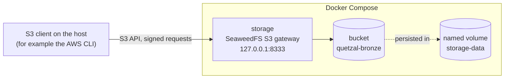

# quetzal-lakehouse

A financial lakehouse built on public data from Guatemala, organized in bronze,
silver and gold layers.

The project is built in small phases. This README describes only what exists
in the repository today; everything else is listed under
[Not built yet](#not-built-yet).

## Current state

- A Docker Compose stack with one service: an S3-compatible object store.
- One bucket, `quetzal-bronze`, created automatically on first start.

There is no ingestion, transformation or data model yet.

## Architecture



## Getting started

Requirements: Docker with Compose v2.

1. Create your local configuration and replace the placeholder values:

   ```bash
   cp .env.example .env
   ```

2. Start the stack and wait until the store is healthy:

   ```bash
   docker compose up -d --wait
   ```

3. Check that the bucket exists:

   ```bash
   docker compose exec storage sh -c "echo s3.bucket.list | weed shell"
   ```

   The output should include a line starting with `quetzal-bronze`.

The S3 endpoint is `http://localhost:8333`. Requests must be signed with the
key pair from `.env`; unsigned requests and wrong keys are rejected.

To stop the stack and keep the data:

```bash
docker compose down
```

Adding `-v` also deletes the volume, and with it every stored object.

## Design decisions

**Object storage behind the S3 API instead of a local folder.** A folder would
be simpler, but every reader and writer would then depend on file paths.
Talking to an S3 endpoint from the start means that moving to AWS S3 changes
configuration (endpoint and credentials), not code.

**SeaweedFS instead of MinIO.** MinIO was the original choice. When this stack
was written (October 2026) the MinIO community repository was archived and its
official images could no longer be pulled from Docker Hub, so a compose file
based on them would not start. SeaweedFS is Apache-2.0 licensed, actively
maintained, and runs as a single container. Two alternatives were rejected:
RustFS, because its first stable release was less than a month old, and a
community fork of MinIO, because it is a third-party build of code its
original authors abandoned.

**One bucket per layer.** Each layer gets its own bucket rather than a prefix
inside a shared one, so access rules and retention can differ per layer: for
example, ingestion may only write to bronze and a dashboard may only read from
gold. Only the bronze bucket exists so far; the others are created when their
layers are built.

**Pinned image tag.** The image starts several components with defaults that
may change between releases. Pinning `4.48` keeps `docker compose up`
reproducible.

**Port published on loopback only.** The S3 port is bound to `127.0.0.1`, so
the store is reachable from the development machine and not from the network.

**Project-specific variable names in `.env`.** The store's key pair is read
from `S3_ACCESS_KEY_ID` and `S3_SECRET_ACCESS_KEY`, not from the standard
`AWS_*` names. Compose gives shell variables priority over `.env`, so reusing
the standard names could silently pass real AWS credentials from a developer's
shell into the local container.

## Known limitations

- The store runs as a single node without replication. It is a local
  development stand-in for S3, not a production deployment.
- The image also starts components this project does not use (a filer UI, an
  admin UI, an Iceberg REST catalog). Their ports are not published to the
  host.

## Not built yet

Planned, in order:

1. Ingestion of the first source into bronze, partitioned by date and safe to
   re-run.
2. Silver layer with dbt and DuckDB, including data quality tests.
3. Gold layer: a star schema and dbt-generated documentation.
4. Two more sources through all three layers.
5. Orchestration of the whole pipeline.
6. Governance: masking of sensitive data, lineage, and separate dev and prod
   environments.
7. A dashboard.
8. Deployment to AWS with Terraform.

Planned sources, checked for availability in October 2026:

- Banco de Guatemala: daily exchange rates (SOAP/XML web service). First
  source.
- Guatecompras: public procurement in the Open Contracting Data Standard
  (monthly JSON files).
- Ministerio de Finanzas Públicas: budget execution (XLSX files and a CKAN
  API).
