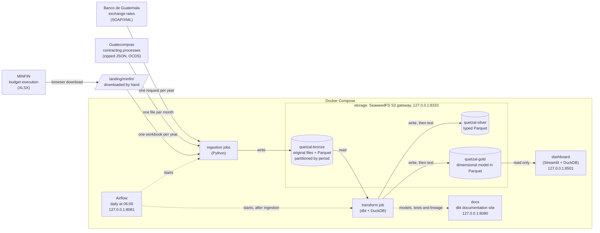
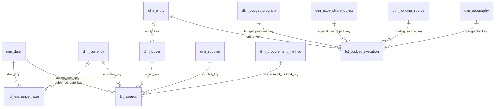

# quetzal-lakehouse

A financial lakehouse built on public data from Guatemala, organized in bronze,
silver and gold layers.

The project is built in small phases. This README describes only what exists
in the repository today; everything else is listed under
[Not built yet](#not-built-yet).

## Current state

- A Docker Compose stack with an S3-compatible object store and one bucket per
  layer: `quetzal-bronze`, `quetzal-silver` and `quetzal-gold`.
- Three ingestion jobs that land public data in the bronze bucket:
  - the Banco de Guatemala exchange rate (quetzales per US dollar, one record
    per published day since November 1989), from a SOAP/XML web service;
  - the contracting processes of Guatecompras, the public procurement system,
    from monthly JSON files in the Open Contracting Data Standard (OCDS);
  - the execution of the central government's expenditure budget, from the
    yearly XLSX workbooks of the Ministerio de Finanzas Públicas (MINFIN),
    downloaded by hand into a landing folder.
- A dbt project that turns the bronze records into typed silver tables and
  then into a dimensional model in gold: three fact tables that share
  dimensions, so budget and procurement can be compared entity by entity. It
  is checked by 195 data tests and eight unit tests.
- A documentation site generated by dbt, with the lineage from bronze to gold.
- Airflow, which runs the whole pipeline every day at 06:00, Guatemala time.
- A Streamlit dashboard over gold: awards, budget execution and the exchange
  rate.
- Governance: natural persons are pseudonymized in gold, every job has a key
  pair that only reaches its own buckets, dbt runs in a dev and a prod
  environment, and the lineage from each source to its consumers is
  documented.

## Architecture



## Getting started

Requirements: Docker with Compose v2, and about 2 GB of disk for the data.

1. Create your local configuration and replace the placeholder values:

   ```bash
   cp .env.example .env
   ```

2. Start the object store and wait until it is healthy:

   ```bash
   docker compose up -d --wait
   ```

3. Load the full exchange rate history into bronze (about ten seconds; the
   first run also builds the job image):

   ```bash
   docker compose run --rm ingestion exchange-rates --from-year 1989
   ```

4. Load the contracting processes published since January 2025 (22 files and
   about 0.7 GB in October 2026; six to seven minutes):

   ```bash
   docker compose run --rm ingestion contracting-processes --from-month 2025-01
   ```

5. Download the budget execution workbooks from the
   [MINFIN open data portal](https://datos.minfin.gob.gt) in a browser: the
   resource "Ejecución Presupuesto de Egresos de Gobierno Central" of the
   datasets "Ejecución Presupuestaria 2025" and "Ejecución Presupuestaria
   2026". Put them in `landing/minfin/`, with any file name, and load them
   (about a minute):

   ```bash
   docker compose run --rm ingestion budget-execution
   ```

6. Build the silver and gold layers of the prod environment and run their
   tests (about four minutes):

   ```bash
   docker compose run --rm transform
   ```

   This runs `dbt build`. It should end with `PASS=223 ... ERROR=0`. To try
   a change without touching prod, run the same build in dev, which writes
   its own silver and gold buckets:

   ```bash
   docker compose run --rm transform-dev
   ```

7. Open the documentation of the models, with their lineage graph, at
   <http://localhost:8080>:

   ```bash
   docker compose up -d docs
   ```

   The site describes what the last transform run built, and takes about
   half a minute to come up.

8. Open the dashboard at <http://localhost:8501> (the first start builds its
   image):

   ```bash
   docker compose up -d dashboard
   ```

   It reads prod gold, so it shows what the last prod transform run built.

Without a range, the two jobs that download refresh the current period
only: the current year of exchange rates, or the current month of
contracting processes. The budget job loads whatever workbooks are in the
landing folder; to refresh the current year, download its workbook again and
replace the old file.

```bash
docker compose run --rm ingestion exchange-rates
docker compose run --rm ingestion contracting-processes
```

Running any of these commands again replaces the same objects. Nothing is
duplicated. The contracting processes job does not even download a month
again while the source has not changed it, and the budget job does not write
a workbook bronze already holds.

### Running it every day with Airflow

Airflow starts the same images on a schedule. It needs the Airflow values of
`.env` (see `.env.example`), including `PROJECT_HOST_DIR`, the absolute path
of this repository, from which its tasks mount `landing/`.

1. Build the job images, which Airflow starts by name:

   ```bash
   docker compose build ingestion transform
   ```

2. Start Airflow (about two minutes the first time):

   ```bash
   docker compose --profile airflow up -d --wait
   ```

3. Open <http://localhost:8081>. The DAG `quetzal_lakehouse` is active and
   runs every day at 06:00, Guatemala time; the button to trigger it runs it
   now. A full run takes about twelve minutes.

To check how old the bronze data is:

```bash
docker compose run --rm transform source freshness
```

The S3 endpoint is `http://localhost:8333`. Requests must be signed with the
key pair from `.env`; unsigned requests and wrong keys are rejected.

To stop the stack, including the documentation site, the dashboard and
Airflow, and keep the data:

```bash
docker compose --profile docs --profile dashboard --profile airflow down
```

Adding `-v` also deletes the volumes, and with them every stored object.

## Bronze layout

Bronze keeps what each source sent, untouched, next to a Parquet copy that
the engine can read. The Parquet copy does not interpret anything: values
stay as text.

### Exchange rates

Each year is stored twice under `banguat/exchange_rates/`:

| Object | Content |
|---|---|
| `raw/year=YYYY/response.xml` | The response of the web service, byte for byte. |
| `parquet/year=YYYY/exchange_rates.parquet` | The same records in columnar form. |

| Column | Example | Meaning |
|---|---|---|
| `moneda` | `2` | Currency code used by the source (2 is the US dollar). |
| `fecha` | `13/10/2026` | Date of the rate, as `dd/mm/yyyy`. |
| `venta` | `7.63381` | Selling rate. |
| `compra` | `7.63381` | Buying rate. |
| `_source_file` | `banguat/exchange_rates/raw/year=2026/response.xml` | Raw object the row was read from. |
| `_ingested_at` | `2026-10-13 23:31:08+00` | When the job that wrote the row started (UTC). |

### Contracting processes

Each month of tender publication is stored twice under
`guatecompras/contracting_processes/`:

| Object | Content |
|---|---|
| `raw/year=YYYY/month=MM/YYYY-MM_Guatecompras_json.zip` | The file published by the source, byte for byte. |
| `parquet/year=YYYY/month=MM/contracting_processes.parquet` | One row per contracting process. |

| Column | Meaning |
|---|---|
| `ocid` | Open contracting identifier of the process. |
| `record` | The OCDS record of the process as JSON text, exactly as written in the file. |
| `_source_file` | Raw object the row was read from. |
| `_ingested_at` | When the job that wrote the row started (UTC). |

The Parquet object also carries, as metadata, the checksum the source
publishes for the month. That is how the job knows a month is unchanged.

### Budget execution

Each fiscal year is stored twice under
`minfin/central_government_expenditure/`:

| Object | Content |
|---|---|
| `raw/year=YYYY/budget_execution.xlsx` | The workbook as downloaded, byte for byte. Its original file name is kept as metadata. |
| `parquet/year=YYYY/budget_execution.parquet` | One row per budget line. |

The Parquet file has the 42 columns of the workbook with their original
names (`ejercicio`, `codigoEntidad`, `asignado`, `devengado`...), every cell
written as text, plus `_source_file` and `_ingested_at`. Workbook cells carry
their own types and numbers come back as floating point values, so a whole
number is written without decimals and any other number with the shortest
digits that read back to the same value. The Parquet object carries the
SHA-256 of the workbook as metadata.

## Silver layout

Silver holds typed tables with English column names, one Parquet file each in
the silver bucket. Column by column descriptions are in the dbt documentation
site.

| Model | One row per | Rows | Main columns |
|---|---|---|---|
| `stg_banguat__exchange_rates` | Published day | 13,487 | `rate_date`, `currency_code`, `buy_rate`, `sell_rate` |
| `stg_guatecompras__processes` | Contracting process | 638,878 | `ocid`, `tender_id`, `status`, `procurement_method_details`, `procurement_category`, `published_date`, `buyer_id`, `buyer_name`, `entity_code` |
| `stg_guatecompras__awards` | Award | 513,471 | `award_id`, `ocid`, `status`, `awarded_date`, `amount`, `currency_code`, `supplier_id` |
| `stg_guatecompras__suppliers` | Supplier awarded at least once | 13,138 | `supplier_id`, `supplier_name`, `legal_type` |
| `stg_minfin__central_government_expenditure` | Budget line and fiscal year | 329,256 | `fiscal_year`, `entity_code`, the fifteen classification codes and their names, `initial_budget`, `current_budget`, `committed`, `accrued`, `paid` |

Row counts are from the run of 2026-10-13, with contracting processes
published from January 2025 and the budgets of 2025 and 2026.

## Gold layout

Gold is a dimensional model: three fact tables that share dimensions. The
date and currency dimensions are shared by exchange rates and awards; the
entity dimension links awards (through the buyer) with the budget. Each table
is one Parquet file in the gold bucket, under a folder with the table's name.
Columns and their descriptions are in the dbt documentation site.



| Table | Grain | Rows |
|---|---|---|
| `fct_exchange_rates` | One row per currency and calendar day, from the first to the last published day. | 13,492 |
| `fct_awards` | One row per award: a contracting process awarded to one supplier. | 513,471 |
| `fct_budget_execution` | One row per budget line and fiscal year. | 329,256 |
| `dim_date` | One row per day, from 1989-01-01 to the end of the current year. | 13,879 |
| `dim_currency` | One row per currency. | 2 |
| `dim_buyer` | One row per public body that buys. | 615 |
| `dim_supplier` | One row per supplier awarded at least once. | 13,138 |
| `dim_procurement_method` | One row per procurement procedure. | 18 |
| `dim_entity` | One row per budget entity of the public sector. | 467 |
| `dim_budget_program` | One row per executing unit and program path of an entity. | 3,731 |
| `dim_expenditure_object` | One row per expenditure item, with its subgroup and group. | 234 |
| `dim_funding_source` | One row per funding source. | 17 |
| `dim_geography` | One row per municipality, with its department. | 371 |

Row counts are from the run of 2026-10-13.

### Exchange rates

`fct_exchange_rates` has five rows more than silver: the days the source never
published. Each takes the last rate published before it and is marked with
`is_published = false`; `rate_published_date` says which day the rate comes
from. `reference_rate` is the rate to convert amounts with: the midpoint of
the buying and selling rates.

Example: the average rate per year.

```sql
select
    d.year,
    c.currency_code,
    count(*) as days,
    round(avg(f.reference_rate), 5) as avg_reference_rate
from fct_exchange_rates as f
inner join dim_date as d using (date_key)
inner join dim_currency as c using (currency_key)
where d.year >= 2024
group by all
order by d.year
```

| year | currency_code | days | avg_reference_rate |
|---|---|---|---|
| 2024 | USD | 366 | 7.75960 |
| 2025 | USD | 365 | 7.67973 |
| 2026 | USD | 286 | 7.63816 |

The 2026 row runs to 2026-10-13.

### Awards

`fct_awards` holds what was awarded, to whom, by whom, when and under which
procedure. Each amount is kept in its own currency, in quetzales, and in US
dollars converted with the reference rate of the day of the award. Processes
that were never awarded have no rows. Cancelled awards are kept and flagged
with `is_cancelled`, so a total of valid awards has to filter them out.

Example: valid awards per year.

```sql
select
    d.year,
    count(*) as awards,
    round(sum(f.awarded_amount_gtq) / 1e6, 1) as million_gtq,
    round(sum(f.awarded_amount_usd) / 1e6, 1) as million_usd
from fct_awards as f
inner join dim_date as d on d.date_key = f.award_date_key
where not f.is_cancelled
group by all
order by d.year
```

| year | awards | million_gtq | million_usd |
|---|---|---|---|
| 2025 | 256,025 | 43,379.2 | 5,653.9 |
| 2026 | 231,504 | 43,578.4 | 5,707.0 |

The 2026 row runs to 2026-10-12. Grouped by procedure, the same table shows
that direct purchases are 91 % of the processes, while public tenders
(7,759 awards) account for the largest amount, Q38,684 million.

### Budget execution

`fct_budget_execution` holds, for each budget line of each fiscal year, the
approved budget, its changes, the current budget and how much of it was
committed, accrued and paid, in quetzales. Only the latest workbook of each
year is kept: 2025 is a closed year, and 2026 accumulates up to the day the
ministry produced the file that was loaded.

`dim_entity` is what lets the two halves of gold meet. Its 19 central
government entities carry their official names from the budget; the other 448
are known only through Guatecompras. Example: accrued budget against valid
awards in 2025, for the central government.

```sql
with budget as (
    select entity_key, sum(accrued) as accrued
    from fct_budget_execution
    where fiscal_year = 2025
    group by entity_key
),
awards as (
    select b.entity_key, sum(f.awarded_amount_gtq) as awarded
    from fct_awards as f
    inner join dim_buyer as b using (buyer_key)
    inner join dim_date as d on d.date_key = f.award_date_key
    where d.year = 2025 and not f.is_cancelled
    group by b.entity_key
)
select
    e.entity_name,
    round(budget.accrued / 1e6, 1) as accrued_million_gtq,
    round(awards.awarded / 1e6, 1) as awarded_million_gtq
from budget
inner join dim_entity as e using (entity_key)
left join awards using (entity_key)
order by budget.accrued desc
```

| entity_name | accrued_million_gtq | awarded_million_gtq |
|---|---|---|
| OBLIGACIONES DEL ESTADO A CARGO DEL TESORO | 54,008.0 | |
| MINISTERIO DE EDUCACIÓN | 24,145.4 | 523.4 |
| SERVICIOS DE LA DEUDA PUBLICA | 18,314.3 | |
| MINISTERIO DE SALUD PÚBLICA Y ASISTENCIA SOCIAL | 13,987.2 | 2,882.7 |
| MINISTERIO DE GOBERNACIÓN | 7,624.3 | 965.7 |
| MINISTERIO DE COMUNICACIONES, INFRAESTRUCTURA Y VIVIENDA | 5,132.3 | 3,165.9 |

The first six of 19 rows. The two entities without awards are obligations
of the Treasury and debt service, which do not buy through Guatecompras. The comparison is indicative: an award is a
promise to pay, possibly over several years, while the accrued budget is what
was received in the year, salaries included.

Any query can be run against the built tables through dbt:

```bash
docker compose run --rm transform show --inline "select * from dim_currency"
```

## Dashboard

The `dashboard` service is a Streamlit app at <http://localhost:8501> with
three pages over prod gold:

| Page | What it shows | Gold tables |
|---|---|---|
| Awards | For a year: valid awards per month and per procurement procedure, how much went to legal entities and to masked suppliers, and the legal entities awarded the most. Amounts in quetzales or US dollars. | `fct_awards`, `dim_date`, `dim_procurement_method`, `dim_supplier` |
| Budget execution | For a fiscal year: current budget, accrued and paid per entity, the share of its budget each one accrued, and its valid awards next to it. | `fct_budget_execution`, `dim_entity`, `fct_awards`, `dim_buyer`, `dim_date` |
| Exchange rate | The daily reference rate over a chosen range, with the days the bank did not publish marked, and the average, lowest and highest rate per year. | `fct_exchange_rates`, `dim_date`, `dim_currency` |

It opens an in-memory DuckDB database with a view per gold table over its
Parquet file, so each query reads the bucket directly; results are cached for
an hour. Its queries are in `dashboard/src/quetzal_dashboard/queries.py` and
are tested against small invented tables. The dashboard is declared in dbt as
the exposure `quetzal_dashboard`, so the lineage graph runs from the sources
to it.

## Data quality

Each source was profiled before its models were written. Silver keeps the
values the source published, and the tests encode what the profile found, so
the build fails on anything new instead of on what is already known.

### Exchange rates

Profile of the full history (13,486 rows, 1989-11-06 to 2026-10-13):

| Finding | How it is handled |
|---|---|
| Five calendar days have no record: 2000-04-02, 2000-05-01, 2001-09-02, 2004-03-06 and 2004-03-07. | They are listed in the seed `banguat_known_missing_dates`. One test fails on any other missing day; another fails if a listed day appears in the data, so the list cannot go stale. |
| On 85 days between 1989-11-16 and 1991-04-09 the selling rate is below the buying rate. | Kept as published. A test requires the selling rate to be at least the buying rate from 1992 on. |
| Buying and selling rates differ on every day up to 2006-12-01 and are equal on every day since 2006-12-02. | A test requires both rates to be equal from 2006-12-02 on. If they diverge again, the meaning of the fields has changed. |

The remaining tests check that no column is null, that `rate_date` is unique,
that the currency is `USD`, that both rates fall between 1 and 20 quetzales
(the historical range is 2.78 to 8.39), and that silver has exactly as many
rows as bronze.

In gold, `dim_date` has no missing days, the fact table has exactly one row
per currency and calendar day, the days it fills in are exactly the five days
listed as missing, and `reference_rate` always lies between the buying and
selling rates.

### Contracting processes

Profile of the processes published from January 2025 to October 2026
(638,884 records, 4.9 GB of JSON):

| Finding | How it is handled |
|---|---|
| Six processes are written twice in their monthly file, with identical content. | Silver keeps one row per process, the most recently updated. Tests require process, tender and award identifiers to be unique. |
| 93 processes have no status. All of them are detailed as "No adjudicado". | Kept. A test fails if a status is missing with any other detail. |
| 4,481 processes (0.7 %) do not list the budget entity of their buyer. They belong to 119 buyers that never list it. | Kept with an empty entity code. A test fails if the share goes above 2 %. |
| The entity code does not identify a buyer: code 11130016 appears with 25 different buyer names. | The dimension is built per buyer, identified by its tax number, with the entity code as an attribute. No buyer has more than one entity code. |
| 145 suppliers appear under more than one spelling of their name. | The most recent name is kept. |
| 289 awards name a supplier that is missing from the list of parties of its process. | Suppliers are read from the awards, so none is lost. Their legal type, which only the list of parties gives, is empty. |
| Timestamps carry the offset of Guatemala, and the engine runs in UTC inside its container. Taking the engine's date would put 28,201 awards on the wrong day. | Dates are converted explicitly to the calendar day in Guatemala. A unit test covers a late evening case. |
| Every award is in quetzales. | The currency must exist in the `currencies` seed, and a gold test fails if an award cannot be expressed in quetzales. |
| 25,942 awards are cancelled, and 51 have an amount of zero. | Kept as published. Cancelled awards are flagged in gold. |

The remaining tests check keys, required columns, code lists, that amounts
are not negative, that every award belongs to a process and to a supplier,
and that every award has exactly one supplier.

In gold, every key of `fct_awards` exists in its dimension, the fact table
has the same number of rows and the same total amount as the awards in
silver, and every award has an amount in quetzales and in dollars. That last
test also fails when exchange rates are older than the awards.

### Budget execution

Profile of the workbooks of 2025 (173,054 lines) and 2026 (156,202 lines):

| Finding | How it is handled |
|---|---|
| Both years have the same 42 columns, and the fifteen classification codes identify each line. | The ingestion job rejects a workbook whose header differs in any way. Silver tests that the fifteen codes and the year are unique. |
| The current budget equals the approved budget plus its changes on every line, and the amount paid never exceeds the amount accrued. | Both rules are tests. |
| 13 lines of 2025 have more accrued than committed, and 1,469 lines of 2026 (0.9 %) have more committed than the current budget. | Kept as published. A test fails if either share grows past its limit (0.1 % and 2 %). |
| Codes below the entity (executing unit, program and so on) repeat across entities with different meanings. | The program dimension is keyed by the whole path, starting with the entity. |

Silver also checks that every bronze line arrives, that the entity code has
eight digits and that amounts are not negative where they cannot be. In gold,
every key of `fct_budget_execution` exists in its dimension and the totals of
each year match silver.

### Unit tests

Eight unit tests run the model logic on small invented inputs: the conversion
of source text to typed values, for exchange rates and for the budget, a
process repeated in the source, a process with several awards and one with
none, a gap in the exchange rates, the conversion of an award with the rate of
its day, the choice of an entity's name, and the masking of natural persons.

dbt runs a model's unit tests before building it, so a logic error that a
unit test catches stops the build before the table is overwritten.

## Personal data

Guatecompras is public data under an open license, and it names people: 7,794
of the 13,138 suppliers awarded since January 2025 are natural persons, and
each process lists contact names, emails, phone numbers and addresses of its
parties, as well as the members of award committees.

| Layer | What it holds | Who can read it |
|---|---|---|
| Bronze | The files as published, with all of it. | Ingestion and both dbt environments. |
| Silver | Only what a model uses: the supplier's tax number, name and legal type. Contact details and committee members are never read out of bronze, because the models list the fields they parse. | The dbt role of its environment. |
| Gold | Natural persons pseudonymized: no tax number, no name. | Anyone who consumes the lakehouse. The dashboard reads it with a key pair that can read nothing else. |

In `dim_supplier`, a natural person, and a supplier whose legal type is
unknown, keeps no identifier and is named "Natural person" or "Supplier of
unknown legal type"; `is_masked` says which rows are. Companies keep their
identifier and name. The key of every supplier is an HMAC-SHA256 of its
identifier with a secret key, so every award of the same supplier still
shares it but nobody without the key can compute it from a tax number.

The silver columns that hold personal data are tagged `personal_data` in the
dbt documentation, and two tests guard gold: one checks that masked rows show
no identity, the other compares gold with silver and fails if the tax number
or name of any such supplier appears in gold.

The dashboard shows masked suppliers only as a group. Its ranking of the
suppliers awarded the most includes legal entities only: ranking masked
suppliers one by one would single out individuals by their amounts, even
without a name.

## Development

The Python projects use [uv](https://docs.astral.sh/uv/).

Ingestion and dashboard tests:

```bash
cd ingestion
uv run pytest
cd ../dashboard
uv run pytest
```

Jobs run through Compose, which hands each one the key pair of its role:
`docker compose run --rm ingestion <job>` for ingestion, and
`docker compose run --rm transform-dev` for dbt while developing. Any dbt
command can follow the service name, for example
`docker compose run --rm transform-dev test --select dim_supplier`. The
dashboard runs from its image too, so a change to it needs
`docker compose up -d --build dashboard`.

## Design decisions

### Storage

**Object storage behind the S3 API instead of a local folder.** A folder would
be simpler, but every reader and writer would then depend on file paths.
Talking to an S3 endpoint from the start means that moving to AWS S3 changes
configuration (endpoint and credentials), not code.

**SeaweedFS instead of MinIO.** MinIO was the original choice. When this stack
was written (October 2026) the MinIO community repository was archived and its
official images could no longer be pulled from Docker Hub, so a compose file
based on them would not start. SeaweedFS is Apache-2.0 licensed, actively
maintained, and runs as a single container. Two alternatives were rejected:
RustFS, because its first stable release was less than a month old, and a
community fork of MinIO, because it is a third-party build of code its
original authors abandoned.

**One bucket per layer.** Each layer gets its own bucket rather than a prefix
inside a shared one, so access rules and retention can differ per layer: for
example, ingestion may only write to bronze and a dashboard may only read from
gold. A bucket is created when its layer is built.

**Pinned image tag.** The image starts several components with defaults that
may change between releases. Pinning `4.48` keeps `docker compose up`
reproducible.

**Port published on loopback only.** The S3 port is bound to `127.0.0.1`, so
the store is reachable from the development machine and not from the network.

**Project-specific variable names in `.env`.** The store's key pair is read
from `S3_ACCESS_KEY_ID` and `S3_SECRET_ACCESS_KEY`, not from the standard
`AWS_*` names. Compose gives shell variables priority over `.env`, so reusing
the standard names could silently pass real AWS credentials from a developer's
shell into the local container.

### Ingestion

**A period of the source is the unit of work.** A job requests one whole
period (a year of exchange rates, a month of contracting processes), stores
it under one partition with fixed object names, and replaces that partition
on every run. Because what is fetched, what is stored and what is overwritten
are the same thing, running a job twice cannot duplicate data and needs no
record of previous runs. The alternative, loading only what was added since
the last run, was rejected: it needs stored state and appends rows, which is
exactly what produces duplicates when a run is retried.

**The partition follows the source.** Exchange rates have about one record
per day, so daily or monthly partitions would create thousands or hundreds of
files with a handful of rows each; yearly partitions give 38 files of about
365 rows. Contracting processes are published as one file per month of tender
publication, so the month is the partition. Partitioning by ingestion date
was rejected for both: it keeps every version the source ever returned, but
the same record would appear in many partitions and every reader would have
to deduplicate.

**Original file and Parquet copy side by side.** The original is what the
source actually sent, so the Parquet files can be rebuilt if the parser turns
out to be wrong, without calling the source again. The Parquet copy exists
because DuckDB and dbt read it directly and do not read XML or zip files.

**Bronze stores text, not types.** Dates and numbers are kept as the source
wrote them, and a contracting process is kept as the JSON text of its record.
Converting or flattening them is a transformation that can fail, and failures
belong in the silver layer, where they are tested and visible. Flattening the
JSON at ingestion was rejected for the same reason: a change in the structure
of the source would break the load instead of a test.

**Large files are read as a stream.** A month of contracting processes is up
to 260 MB of JSON. The job reads it in chunks and cuts it into records, so
the document is never held in memory as a whole, and each record is stored as
the exact text of the file rather than a re-encoded copy.

**Downloads are checked before anything is overwritten.** An exchange rate
response is rejected if it is not valid XML, if the number of records does
not match the count the service declares, if it is empty, or if it contains
dates from another year. A monthly file of contracting processes is rejected
if its SHA-256 differs from the one the source publishes, if it holds records
of another month, or if it is empty while bronze already has that month. A
rejected download leaves the stored partition untouched, so an outage at the
source cannot erase data that was already loaded.

**A month the source has not changed is skipped.** Guatecompras rewrites its
files as processes move forward, including those of past months, and
publishes a checksum for each. The job stores that checksum with the Parquet
object and downloads a month only when the published checksum differs. The
checksum goes on the object written last: if a run dies between the two
writes, the month does not look up to date and the next run loads it again.
This is not a record of previous runs; it is a comparison between the source
and what is stored.

**Retries are left to whoever runs the job.** Only connection failures are
retried in-process. Any other error stops the run with a non-zero exit code.
Since re-running is always safe, retry policy can live in the scheduler
instead of being reimplemented inside each job.

**Hand-written SOAP request.** The request is a ten-line XML template. A SOAP
library such as zeep would add a large dependency to generate the same text.

**A source that blocks automated clients is downloaded by hand.** The MINFIN
portal answers the pipeline's HTTP client with a bot challenge. Getting past
it by imitating a browser would be working around a protection the publisher
chose, and a pipeline that depends on that can break any day. So a person
downloads the workbooks in a browser into `landing/minfin/`, which Compose
mounts read-only into the ingestion container, and everything after that is
automated. The folder is ignored by git.

**The fiscal year comes from the content, not the file name.** Whoever
downloads a workbook names it, so the name cannot be trusted. The job reads
the `ejercicio` column, rejects a workbook that mixes years, and refuses to
load two files of the same year at once rather than guess which is the right
one. Every file is read and checked before anything is written.

**Only the latest workbook of each year is kept.** A new download of the
current year replaces the previous one, like every other partition. Keeping
each download as a snapshot was rejected: with downloads made by hand the
snapshots would fall on arbitrary dates, and every consumer would have to
pick one.

**A workbook bronze already holds is not written again.** The job computes
the SHA-256 of each workbook and compares it with the one stored with the
Parquet object, as the contracting processes job does with the checksum its
source publishes. The landing folder is never modified: deleting files there
is left to the person who put them.

**One image, jobs selected by name.** The three jobs live in one Python
package and one image; the first argument chooses the job. They share the
storage client, the HTTP client and the clock.

**Locked dependencies, fixed runtime.** `uv.lock` records the exact version
of every dependency. The job image installs from it using a fixed Python
minor version and a pinned uv version, so it does not depend on what is
installed on the machine that builds it.

### Transformation

**Silver is Parquet in its own bucket; DuckDB is only the engine.** dbt writes
each model to the silver bucket and DuckDB keeps nothing but a view over the
file. Storage stays separate from compute: any engine that reads Parquet can
use silver, and the DuckDB database file is disposable. Keeping the tables
inside a DuckDB file was rejected because the data would leave the object
store and only DuckDB could read it. A table format such as Iceberg was left
out for now: it would add a catalog before there is a single model to manage.

**Source anomalies are kept and documented, not fixed.** Silver changes types,
names and shape, never values. Missing days are not filled in and odd values
are not corrected, because a row the source never published is an invention.
Each known anomaly is declared next to a test that fails on any new one.
Where the data changes every day, the test is a rule or a share rather than a
fixed count.

**Strict conversions.** Dates and numbers are converted with casts that raise
an error on unexpected input, so a format change at the source stops the
build instead of producing nulls that surface later.

**Deduplicate only where the source repeats itself.** Exchange rates cannot
hold the same date twice in bronze by construction, so their model does not
deduplicate: a failing uniqueness test is more useful than a model that
silently picks one row. Guatecompras does repeat processes inside its files,
so its models keep the most recently updated copy, and the uniqueness tests
check the result.

**Models list the fields they read.** A contracting process is a large
nested document. Each silver model names the fields it parses out of it;
everything else, including contact details of people, stays in bronze. It
also keeps the models independent of fields they do not use.

**Entity codes stay text.** The code of a budget entity is an identifier
that two sources share, not a number to compute with, so it is kept as the
same eight-character text in both, which is what makes them join.

**Business dates are days in Guatemala.** A timestamp is turned into a date
with an explicit conversion to the time zone of Guatemala, not with the time
zone of the machine the engine runs on.

**Exact decimals.** Rates are `DECIMAL(10,6)`, matching the six decimals the
source uses, and amounts are `DECIMAL(18,2)`. Floating point would make the
comparison between buying and selling rates unreliable.

**Full rebuild on every run.** Every model is rebuilt from all of bronze each
time. It is simple and safe to repeat. The cost is time: re-reading 4.9 GB of
JSON takes most of the three minutes of a build.

**DuckDB works inside a memory limit.** The engine is capped below the memory
of its container and spills to disk beyond that, instead of being killed.

**dbt Core with dbt-duckdb, not dbt v2.** When this was written the DuckDB
adapter of the new Fusion engine was in beta and its bundled driver could not
load DuckDB extensions, including the one that reads S3.

**Layer folders, dbt model names.** Models live in folders named after the
lakehouse layers (`models/silver`, `models/gold`). Model names follow the dbt
conventions: `stg_<source>__<entity>` for a cleanup of a source table, which
is what dbt calls a staging model, and `fct_` and `dim_` for facts and
dimensions.

**The DuckDB database is kept in a volume, and is still disposable.** It
holds views over the Parquet files and the seeds, nothing else. Keeping it
between runs lets separate dbt commands, and the documentation site, see what
the last build produced. Deleting it loses nothing.

### Dimensional model

**Exchange rates: one row per currency and calendar day.** The source skips
five days. With a row for every day, any other fact finds the rate for its
own date with a plain join. The alternative, keeping only published days, was
rejected because every consumer would have to decide what to do on a day
without a rate, and they could decide differently.

**Gaps are filled in gold, not in silver.** Silver holds what the source
published. Carrying a rate over to a skipped day is a business rule, so it
lives in gold, and the rows it creates are flagged and say which day their
rate comes from.

**One reference rate for conversions.** Until 2006-12-01 the source publishes
different buying and selling rates. Gold adds `reference_rate`, their
midpoint, so that everything downstream converts with the same number. Since
2006-12-02 both rates are equal and the midpoint is the published rate; before
that it is a computed value, and the column description says so. It is
calculated with exact decimals, which needs one more decimal place than the
source uses.

**Awards: one row per award.** An award is the event that carries money: one
process, one supplier, one amount, one date. A row per process was rejected
because a process can be awarded to several suppliers, and the supplier would
be lost. The price is that processes never awarded are not in this table.

**Cancelled awards stay, flagged.** Removing them would make every sum
correct without a filter, but would hide how much is cancelled. They are kept
with `is_cancelled`, and the description of the table says that a total of
valid awards must filter on it.

**Amounts are converted once, in gold.** Each award carries its amount in
dollars, computed with the reference rate of the day of the award. Every
consumer gets the same figure, and the rate used is the one in
`fct_exchange_rates` for that day.

**A buyer is not a budget entity.** The entity code of the public sector's
institutional classifier is what the budget uses, and several buyers can
share one. The buyer dimension has one row per body that buys, identified by
its tax number, and keeps the entity code as an attribute.

**Budget: one row per budget line and fiscal year.** That is the grain of
the source, and the most detailed one: any summary by entity, program, item,
source or place is computed from it. Aggregating to entity, item and source
was rejected because program, executing unit and place could not be
recovered from gold.

**Classifiers with a hierarchy become dimensions; bare codes stay in the
fact.** The program path, the expenditure item with its subgroup and group,
the funding source and the place have names and hierarchies of their own.
Budget type, economic class and lending organism are just a code and a name
on each line, so they stay in the fact table as degenerate attributes.

**One entity dimension for budget and procurement.** `dim_entity` holds every
entity code either source mentions. The 19 central government entities take
their official names from the budget; the rest take the buyer name used in
most of their processes, and `name_source` says which is which. Keeping only
the 19 official entities was rejected, because most purchases are made by
municipalities and decentralized bodies.

**Buyers point to their entity.** `dim_buyer` carries `entity_key`, a link
from one dimension to another, so an award reaches its entity through its
buyer. The alternative, adding the entity to the awards fact table, would
have needed a placeholder entity for the buyers that never name theirs.

**Budget amounts stay in quetzales.** A budget accumulates over a year, so
there is no single day whose rate would convert it.

**Dimensions keep the latest description.** A buyer or supplier that changes
name appears with its most recent one, and earlier names are not kept. With
a full rebuild from the current state of the source there is no history to
keep.

**Surrogate keys.** Dimensions are keyed by a hash of their natural key, and
`dim_date` by the date as the integer YYYYMMDD. A hash is the same on every
rebuild, so it needs no counter, unlike sequential integers, which would have
to remember what was assigned before. It also lets a fact table compute its
foreign keys without joining the dimension; tests then check that every key
exists.

**The calendar does not depend on the facts.** `dim_date` is generated from a
fixed start to the end of the current year instead of from the dates present
in a fact table, so every fact table can share it. Awards use it twice, for
the day of the award and the day the tender was published.

**Documentation is served locally.** `dbt docs` is exposed as a Compose
service. Publishing it would need a CI workflow that runs the whole pipeline
and is left for later.

### Governance

**Pseudonymize in gold; silver stays restricted.** Gold is the layer others
consume, so that is where natural persons stop being identifiable. Silver
keeps the original values, readable only by the dbt role of its environment,
so the data team can still check a specific case. Masking already in silver
was rejected because it would leave no layer short of raw JSON to do that.
Showing clear or masked values depending on who asks (dynamic masking) needs
users and roles in the query engine, which DuckDB does not have.

**A keyed hash, not a plain one.** The supplier key used to be an MD5 of the
tax number. Tax numbers are few enough to hash every possible one, so that
key revealed the person behind it even with the name hidden. The key is now
an HMAC-SHA256 with a secret key per environment.

**The secret stays out of SQL.** DuckDB has no HMAC and cannot read
environment variables, and a key written into a model would appear in the
compiled SQL and on the documentation site. A dbt-duckdb plugin
(`transform/plugins/pseudonymization.py`) registers `pseudonymize()` on every
connection and reads the key from the environment. The function receives
values in batches: called once per row it cost about 5 ms a row, which made
the awards table take hours; in batches it takes seconds.

**Unknown means masked.** A supplier whose legal type the source does not
give could be a person, so it is masked like one.

**One key pair per role.** The store has an identity per role, created at
start by `storage-init`: ingestion can read and write bronze only; dbt in
prod can read bronze and write prod silver and gold; dbt in dev can read
bronze and write dev silver and gold, and cannot even read prod; the
dashboard can read prod gold and nothing else. This is what
the bucket per layer was chosen for in the first place. The administrator key
is not used by any job.

**Two environments, one bronze.** Bronze is the same for both, because
downloading the sources twice would add nothing. Silver and gold have a
bucket per environment, and the dbt targets `dev` and `prod` differ only in
what their Compose services pass in: buckets, key pair and pseudonymization
key. dbt defaults to dev, and Airflow runs prod. Two complete stacks were
rejected as double downloads, disk and memory on one machine; prefixes inside
shared buckets, for the same reason buckets were chosen per layer.

**Lineage at three levels.** Each source declares where its data comes from,
which job loads it, where the original files are, how often it refreshes and
whether it holds personal data. dbt draws the graph from sources to models,
and exposures declare the dashboard and the analyses that consume gold, so
the graph shows what a change would affect. Each silver row keeps the bronze file it came
from and when it was loaded. Emitting OpenLineage events to a Marquez server
was left out: it would add services to a machine that already runs Airflow,
for a graph dbt already draws.

### Orchestration

**Airflow, not Dagster.** Dagster's model of assets and partitions fits this
project closely: every bronze partition and dbt model would be an asset with
lineage drawn for free. Airflow was chosen because it is the orchestrator
most teams run and most job descriptions ask for. The price is a task-based
view: Airflow knows the four tasks, not the tables they produce.

**Airflow schedules; the images do the work.** Each task starts the
ingestion or transform image as a container, exactly like `docker compose
run`. Installing the jobs and dbt inside the Airflow image was rejected: three
sets of dependencies would share one environment and could clash, and the
jobs would no longer run the same way with or without Airflow. The price is
the Docker socket, mounted into the scheduler.

**One DAG, one dbt task.** The three ingestion tasks run in parallel, since
they share nothing, and `dbt build` runs once all of them succeed. dbt
already orders models and tests, so it runs as a single task; splitting it
into one Airflow task per model (with Cosmos) would add a dbt parse inside
Airflow for little gain at this size.

**The full range, every day.** Each run loads the exchange rates of the
current year, Guatecompras from January 2025 and whatever is in the landing
folder. A shorter daily window with a weekly full refresh was rejected as two
schedules to reason about.

**Retries live in Airflow.** Every job can be repeated safely, so a failed
task is retried twice, ten minutes apart. Missed days are not caught up
(`catchup=False`) and only one run is active at a time, because each run
already refreshes everything.

**Lightweight setup.** The local executor runs tasks inside the scheduler, so
there is no Celery or Redis; Postgres holds Airflow's own state. The storage
key pair reaches the containers through `private_environment`, which Airflow
does not show in its interface or write to its logs.

### Dashboard

**Streamlit.** A light Python app whose pages are code in this repository,
reviewed and tested like the rest. Evidence was the closest alternative:
pages written in SQL and Markdown and built into a static site, cheap to
host. It was rejected because the site has to be rebuilt after every dbt run,
and the data it shows is shipped to the viewer's browser. Metabase and
Superset are full BI tools, but they keep their dashboards in their own
database instead of in git, and they need more memory and services (a JVM;
Postgres, Redis and workers) than this machine has to spare.

**Read gold where it is.** DuckDB, the engine that builds the lakehouse, reads
the Parquet files of gold straight from the bucket. Copying gold into a
database for the dashboard was rejected as a second copy to keep in step; the
price is that a query reads the files over the network, which an hour of
caching makes rare. Results are at most an hour older than the last build.

**Queries in the dashboard, not in dbt.** Each page asks gold its own
questions, in SQL kept in one module. Models built only for the dashboard
were left out until a question repeats across pages or consumers; then it
belongs in dbt, where it is tested and documented.

**Its own read-only key.** The dashboard gets a key pair that can read prod
gold and nothing else, so even a flaw in the app cannot reach silver, where
the personal data is in the clear. Streamlit is also kept from contacting
outside services: no usage statistics, and no lookup of the machine's public
IP at start.

## Known limitations

- The store runs as a single node without replication. It is a local
  development stand-in for S3, not a production deployment.
- The image also starts components this project does not use (a filer UI, an
  admin UI, an Iceberg REST catalog). Their ports are not published to the
  host.
- Only the US dollar is ingested.
- Overwriting a partition discards what it held before. If a source revises
  a past value, the previous one is not kept.
- The two objects of a partition are written one after the other, not
  atomically. A failure between them leaves the original file newer than the
  Parquet file until the job runs again.
- The exchange rate source repeats the last published rate on days without a
  new one, such as weekends. Bronze and silver keep those rows as they come.
- Guatecompras rewrites the files of recent months every day. On 2026-10-14
  all 22 months from January 2025 had a new checksum while January 2020 did
  not, so the daily run downloads about 0.7 GB; the checksum only saves the
  downloads of a second run on the same day.
- Of a contracting process only the tender, its awards, the buyer and the
  suppliers are modelled. Bids, items, documents and contracts stay in bronze,
  and processes that were never awarded do not reach gold.
- 487 suppliers have no legal type, so whether they are natural persons is
  unknown.
- Silver keeps personal data in the clear. Only bucket permissions protect
  it, and the administrator key can read everything.
- Dev reads the real bronze, personal data included. Dev only differs from
  prod in where it writes.
- Changing a pseudonymization key changes every supplier key of that
  environment; nothing keeps the old ones.
- Permissions are per bucket and per role, not per column or per person.
- Silver and gold are plain Parquet without a table format: no transactions,
  no schema evolution and no history of previous versions. Each file is
  replaced on every run and the data tests run afterwards; a failed data test
  therefore reports a problem in a file that is already written.
- `dim_date` does not mark public holidays.
- `dim_currency` is maintained by hand from a seed file.
- The hash keys make the fact tables unreadable without joining the
  dimensions.
- The documentation site is only available to someone running the project.
- The freshness check is a separate command and is not part of `dbt build`.
- The budget depends on someone downloading the workbooks. Nothing reminds
  them, and the freshness check only warns after 35 days.
- The date up to which the current year's budget is accumulated is not in
  the workbook. Only the day of the download is known, in the file name.
- Loading an older workbook of a year after a newer one replaces the newer
  one; the job cannot tell which is more recent.
- Only the expenditure of the central government is loaded: not its income,
  and not the budgets of decentralized entities or municipalities. Those
  entities carry the names buyers use in Guatecompras, not official names.
- Airflow runs only while this machine and Docker are on. A day it misses is
  not run later; the next run refreshes everything anyway.
- The Airflow interface has no login. It is published on loopback only, for
  local development.
- Airflow reaches Docker through its socket, which gives it full control
  over Docker on this machine.
- The DAG has no automated tests. It was checked by parsing it in Airflow
  and by running it end to end.
- The dashboard has no login. Like the other interfaces, it is published on
  loopback only.
- The dashboard caches results for an hour, so after a build it can show the
  previous data for up to an hour. Restarting it clears the cache.
- The awards page ranks legal entities only; the suppliers awarded the most
  overall may include natural persons, which it shows only as a group.
- The dashboard's pages have no automated tests; its queries do. The pages
  were checked by opening them against the data of 2026-10-14.
- Everything shares one virtual machine of Docker Desktop. During one run a
  dbt build starved the Airflow scheduler for 36 seconds, Airflow declared it
  dead and killed the dbt task, and the retry succeeded. The scheduler now
  gets 120 seconds before being declared dead; that has not been proven to
  prevent it. Docker Desktop itself hung three times during development and
  had to be restarted.

## Not built yet

Planned, in order:

1. Deployment to AWS with Terraform.

Also not built: publishing the dbt documentation (for example on GitHub
Pages) and a table format for silver and gold.

## Data sources

- Exchange rates: [Banco de Guatemala](https://www.banguat.gob.gt/), web
  service `TipoCambio`.
- Contracting processes: [Guatecompras](https://ocds.guatecompras.gt/),
  Ministerio de Finanzas Públicas, published in the Open Contracting Data
  Standard under the
  [Creative Commons Attribution 4.0](https://creativecommons.org/licenses/by/4.0/)
  license.
- Budget execution: [Ministerio de Finanzas Públicas](https://datos.minfin.gob.gt/),
  datasets "Ejecución Presupuestaria". The 2025 dataset is published under the
  Creative Commons Attribution license; the 2026 dataset does not state a
  license yet.
