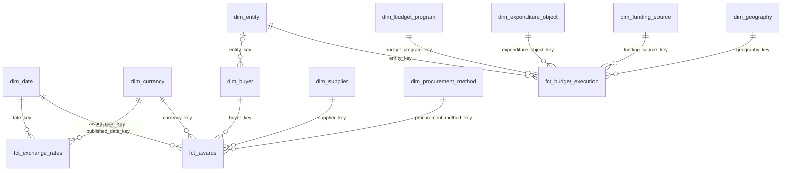

# Data model

[Back to the README](../README.md)

The lakehouse has three layers in three buckets: bronze keeps what each source
sent, silver holds typed tables, and gold holds the dimensional model the
dashboard reads.

## Bronze layout

Bronze keeps what each source sent, untouched, next to a Parquet copy that
the engine can read. The Parquet copy does not interpret anything: values
stay as text.

### Exchange rates

Each year is stored twice under `banguat/exchange_rates/`:

| Object | Content |
|---|---|
| `raw/year=YYYY/response.xml` | The response of the web service, byte for byte. |
| `parquet/year=YYYY/exchange_rates.parquet` | The same records in columnar form. |

| Column | Example | Meaning |
|---|---|---|
| `moneda` | `2` | Currency code used by the source (2 is the US dollar). |
| `fecha` | `13/10/2026` | Date of the rate, as `dd/mm/yyyy`. |
| `venta` | `7.63381` | Selling rate. |
| `compra` | `7.63381` | Buying rate. |
| `_source_file` | `banguat/exchange_rates/raw/year=2026/response.xml` | Raw object the row was read from. |
| `_ingested_at` | `2026-10-13 23:31:08+00` | When the job that wrote the row started (UTC). |

### Contracting processes

Each month of tender publication is stored twice under
`guatecompras/contracting_processes/`:

| Object | Content |
|---|---|
| `raw/year=YYYY/month=MM/YYYY-MM_Guatecompras_json.zip` | The file published by the source, byte for byte. |
| `parquet/year=YYYY/month=MM/contracting_processes.parquet` | One row per contracting process. |

| Column | Meaning |
|---|---|
| `ocid` | Open contracting identifier of the process. |
| `record` | The OCDS record of the process as JSON text, exactly as written in the file. |
| `_source_file` | Raw object the row was read from. |
| `_ingested_at` | When the job that wrote the row started (UTC). |

The Parquet object also carries, as metadata, the checksum the source
publishes for the month. That is how the job knows a month is unchanged.

### Budget execution

Each fiscal year is stored twice under
`minfin/central_government_expenditure/`:

| Object | Content |
|---|---|
| `raw/year=YYYY/budget_execution.xlsx` | The workbook as downloaded, byte for byte. Its original file name is kept as metadata. |
| `parquet/year=YYYY/budget_execution.parquet` | One row per budget line. |

The Parquet file has the 42 columns of the workbook with their original
names (`ejercicio`, `codigoEntidad`, `asignado`, `devengado`...), every cell
written as text, plus `_source_file` and `_ingested_at`. Workbook cells carry
their own types and numbers come back as floating point values, so a whole
number is written without decimals and any other number with the shortest
digits that read back to the same value. The Parquet object carries the
SHA-256 of the workbook as metadata.

## Silver layout

Silver holds typed tables with English column names, one Parquet file each in
the silver bucket. Column by column descriptions are in the dbt documentation
site.

| Model | One row per | Rows | Main columns |
|---|---|---|---|
| `stg_banguat__exchange_rates` | Published day | 13,487 | `rate_date`, `currency_code`, `buy_rate`, `sell_rate` |
| `stg_guatecompras__processes` | Contracting process | 638,878 | `ocid`, `tender_id`, `status`, `procurement_method_details`, `procurement_category`, `published_date`, `buyer_id`, `buyer_name`, `entity_code` |
| `stg_guatecompras__awards` | Award | 513,471 | `award_id`, `ocid`, `status`, `awarded_date`, `amount`, `currency_code`, `supplier_id` |
| `stg_guatecompras__suppliers` | Supplier awarded at least once | 13,138 | `supplier_id`, `supplier_name`, `legal_type` |
| `stg_minfin__central_government_expenditure` | Budget line and fiscal year | 329,256 | `fiscal_year`, `entity_code`, the fifteen classification codes and their names, `initial_budget`, `current_budget`, `committed`, `accrued`, `paid` |

Row counts are from the run of 2026-10-13, with contracting processes
published from January 2025 and the budgets of 2025 and 2026.

## Gold layout

Gold is a dimensional model: three fact tables that share dimensions. The
date and currency dimensions are shared by exchange rates and awards; the
entity dimension links awards (through the buyer) with the budget. Each table
is one Parquet file in the gold bucket, under a folder with the table's name.
Columns and their descriptions are in the dbt documentation site.



| Table | Grain | Rows |
|---|---|---|
| `fct_exchange_rates` | One row per currency and calendar day, from the first to the last published day. | 13,492 |
| `fct_awards` | One row per award: a contracting process awarded to one supplier. | 513,471 |
| `fct_budget_execution` | One row per budget line and fiscal year. | 329,256 |
| `dim_date` | One row per day, from 1989-01-01 to the end of the current year. | 13,879 |
| `dim_currency` | One row per currency. | 2 |
| `dim_buyer` | One row per public body that buys. | 615 |
| `dim_supplier` | One row per supplier awarded at least once. | 13,138 |
| `dim_procurement_method` | One row per procurement procedure. | 18 |
| `dim_entity` | One row per budget entity of the public sector. | 467 |
| `dim_budget_program` | One row per executing unit and program path of an entity. | 3,731 |
| `dim_expenditure_object` | One row per expenditure item, with its subgroup and group. | 234 |
| `dim_funding_source` | One row per funding source. | 17 |
| `dim_geography` | One row per municipality, with its department. | 371 |

Row counts are from the run of 2026-10-13.

### Exchange rates

`fct_exchange_rates` has five rows more than silver: the days the source never
published. Each takes the last rate published before it and is marked with
`is_published = false`; `rate_published_date` says which day the rate comes
from. `reference_rate` is the rate to convert amounts with: the midpoint of
the buying and selling rates.

Example: the average rate per year.

```sql
select
    d.year,
    c.currency_code,
    count(*) as days,
    round(avg(f.reference_rate), 5) as avg_reference_rate
from fct_exchange_rates as f
inner join dim_date as d using (date_key)
inner join dim_currency as c using (currency_key)
where d.year >= 2024
group by all
order by d.year
```

| year | currency_code | days | avg_reference_rate |
|---|---|---|---|
| 2024 | USD | 366 | 7.75960 |
| 2025 | USD | 365 | 7.67973 |
| 2026 | USD | 286 | 7.63816 |

The 2026 row runs to 2026-10-13.

### Awards

`fct_awards` holds what was awarded, to whom, by whom, when and under which
procedure. Each amount is kept in its own currency, in quetzales, and in US
dollars converted with the reference rate of the day of the award. Processes
that were never awarded have no rows. Cancelled awards are kept and flagged
with `is_cancelled`, so a total of valid awards has to filter them out.

Example: valid awards per year.

```sql
select
    d.year,
    count(*) as awards,
    round(sum(f.awarded_amount_gtq) / 1e6, 1) as million_gtq,
    round(sum(f.awarded_amount_usd) / 1e6, 1) as million_usd
from fct_awards as f
inner join dim_date as d on d.date_key = f.award_date_key
where not f.is_cancelled
group by all
order by d.year
```

| year | awards | million_gtq | million_usd |
|---|---|---|---|
| 2025 | 256,025 | 43,379.2 | 5,653.9 |
| 2026 | 231,504 | 43,578.4 | 5,707.0 |

The 2026 row runs to 2026-10-12. Grouped by procedure, the same table shows
that direct purchases are 91 % of the processes, while public tenders
(7,759 awards) account for the largest amount, Q38,684 million.

### Budget execution

`fct_budget_execution` holds, for each budget line of each fiscal year, the
approved budget, its changes, the current budget and how much of it was
committed, accrued and paid, in quetzales. Only the latest workbook of each
year is kept: 2025 is a closed year, and 2026 accumulates up to the day the
ministry produced the file that was loaded.

`dim_entity` is what lets the two halves of gold meet. Its 19 central
government entities carry their official names from the budget; the other 448
are known only through Guatecompras. Example: accrued budget against valid
awards in 2025, for the central government.

```sql
with budget as (
    select entity_key, sum(accrued) as accrued
    from fct_budget_execution
    where fiscal_year = 2025
    group by entity_key
),
awards as (
    select b.entity_key, sum(f.awarded_amount_gtq) as awarded
    from fct_awards as f
    inner join dim_buyer as b using (buyer_key)
    inner join dim_date as d on d.date_key = f.award_date_key
    where d.year = 2025 and not f.is_cancelled
    group by b.entity_key
)
select
    e.entity_name,
    round(budget.accrued / 1e6, 1) as accrued_million_gtq,
    round(awards.awarded / 1e6, 1) as awarded_million_gtq
from budget
inner join dim_entity as e using (entity_key)
left join awards using (entity_key)
order by budget.accrued desc
```

| entity_name | accrued_million_gtq | awarded_million_gtq |
|---|---|---|
| OBLIGACIONES DEL ESTADO A CARGO DEL TESORO | 54,008.0 | |
| MINISTERIO DE EDUCACIÓN | 24,145.4 | 523.4 |
| SERVICIOS DE LA DEUDA PUBLICA | 18,314.3 | |
| MINISTERIO DE SALUD PÚBLICA Y ASISTENCIA SOCIAL | 13,987.2 | 2,882.7 |
| MINISTERIO DE GOBERNACIÓN | 7,624.3 | 965.7 |
| MINISTERIO DE COMUNICACIONES, INFRAESTRUCTURA Y VIVIENDA | 5,132.3 | 3,165.9 |

The first six of 19 rows. The two entities without awards are obligations
of the Treasury and debt service, which do not buy through Guatecompras. The comparison is indicative: an award is a
promise to pay, possibly over several years, while the accrued budget is what
was received in the year, salaries included.

Any query can be run against the built tables through dbt:

```bash
docker compose run --rm transform show --inline "select * from dim_currency"
```

## Dashboard

The `dashboard` service is a Streamlit app at <http://localhost:8501> with
three pages over prod gold:

| Page | What it shows | Gold tables |
|---|---|---|
| Awards | For a year: valid awards per month and per procurement procedure, how much went to legal entities and to masked suppliers, and the legal entities awarded the most. Amounts in quetzales or US dollars. | `fct_awards`, `dim_date`, `dim_procurement_method`, `dim_supplier` |
| Budget execution | For a fiscal year: current budget, accrued and paid per entity, the share of its budget each one accrued, and its valid awards next to it. | `fct_budget_execution`, `dim_entity`, `fct_awards`, `dim_buyer`, `dim_date` |
| Exchange rate | The daily reference rate over a chosen range, with the days the bank did not publish marked, and the average, lowest and highest rate per year. | `fct_exchange_rates`, `dim_date`, `dim_currency` |

It opens an in-memory DuckDB database with a view per gold table over its
Parquet file, so each query reads the bucket directly; results are cached for
an hour. Its queries are in `dashboard/src/quetzal_dashboard/queries.py` and
are tested against small invented tables. The dashboard is declared in dbt as
the exposure `quetzal_dashboard`, so the lineage graph runs from the sources
to it.
