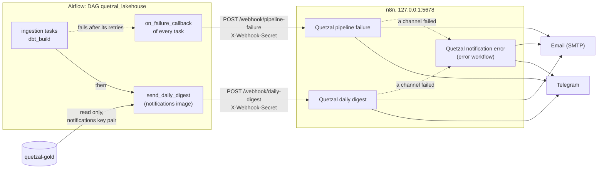

# Notifications

[Back to the README](../README.md)

Each daily run ends with a short digest sent to Telegram and by email, a task
that fails for good is reported at once, and a notification that cannot be
delivered is reported too. Airflow keeps the pipeline: it computes the digest
from gold and posts it, with any failure, to a self-hosted n8n (Community
Edition). n8n only checks what it receives, words the messages and sends
them.

<!-- Placeholder: replace images/notifications-telegram.png with a screenshot of a daily digest in Telegram. -->


*A daily digest in Telegram.*

## How it works



1. After `dbt build`, the task `send_daily_digest` starts the
   `quetzal-lakehouse-notifications` image, which reads a few figures from
   prod gold with its own key pair (it can read gold and nothing else) and
   posts them as JSON to n8n.
2. Every task of the DAG has a failure callback. Once a task has used up its
   retries, the callback posts the task, the run ID and a short error to a
   second webhook. It runs inside Airflow and uses only the Python standard
   library.
3. Both requests carry a secret shared with n8n in the `X-Webhook-Secret`
   header. n8n refuses a request without it, before running the workflow.
4. Each workflow checks the payload and answers 400 with the reasons when it
   is not what it was written for, so the Airflow task fails and says why. It
   then formats a plain text message and sends it to Telegram and by email.
   Both channels are always tried; if one fails, the workflow fails after
   trying the other, and n8n runs its error workflow, which sends what failed
   and a link to the execution.

Without `NOTIFICATIONS_WEBHOOK_URL` the digest job ends with exit code 3
before reading gold, Airflow marks the task as skipped, and the callback
sends nothing: the pipeline runs the same without n8n.

## What the digest says

| Part | Content |
|---|---|
| Exchange rate | The latest US dollar rate on or before the day of the run, its change from the day before in quetzales and in percent, and whether the bank published it or it carries over the last published one. |
| Awards | The valid awards dated the day before the run, their number and total in quetzales and dollars, and the totals of the year so far. |
| Masked suppliers | The awards of that day to natural persons and suppliers of unknown legal type, as a group: number and total. |
| Largest awards | The five largest awards of that day to legal entities, with supplier, buyer, procedure and process identifier. |
| Rows in gold | The row counts of `fct_exchange_rates`, `fct_awards` and `fct_budget_execution`. |

The message opens with an alert section when the dollar rate moved more than
`NOTIFICATIONS_RATE_CHANGE_ALERT_PERCENT` from the day before, or when an
award is above `NOTIFICATIONS_AWARD_ALERT_GTQ`. An award to a masked supplier
above the threshold is flagged without its amount or buyer, which together
with the day would point to the person (see [Governance](governance.md)).

## The payloads

Both payloads carry `kind` and `schema_version`, and the workflows refuse any
other kind or version.

The daily digest (`kind: daily_digest`), as printed by
`docker compose run --rm notifications digest`:

| Field | Meaning |
|---|---|
| `run_id`, `run_date`, `generated_at` | The Airflow run, the day of the run in Guatemala, and when the digest was computed (UTC). |
| `exchange_rate` | `currency`, `date`, `rate`, `is_published`, `rate_published_date`, `previous_date`, `previous_rate`, `change`, `change_percent`; `null` if gold has no rate. |
| `awards` | `date`, `count`, `total_gtq`, `total_usd`, `year_to_date` (the same totals), `masked_suppliers` (the same totals and `largest_gtq`), and `largest`, a list of `ocid`, `supplier_name`, `buyer_name`, `procurement_procedure`, `amount_gtq`, `amount_usd`. |
| `row_counts` | Rows per fact table. |

The pipeline failure (`kind: pipeline_failure`): `dag_id`, `task_id`,
`run_id`, `try_number`, `failed_at` (UTC) and `error`, the first 500
characters of the exception.

`automation/n8n/samples/` has one invented example of each.

## Settings

All of them go in `.env`; `.env.example` lists them with placeholder values.

| Variable | Read by | Meaning |
|---|---|---|
| `N8N_ENCRYPTION_KEY` | n8n | Encrypts the credentials n8n stores. |
| `NOTIFICATIONS_WEBHOOK_URL` | the digest job, the failure callback | Base URL of n8n's webhooks from the Compose network: `http://n8n:5678/webhook`. Empty turns notifications off. |
| `NOTIFICATIONS_WEBHOOK_SECRET` | the digest job, the failure callback; n8n through a credential | The shared secret of the `X-Webhook-Secret` header. |
| `S3_NOTIFICATIONS_ACCESS_KEY_ID`, `S3_NOTIFICATIONS_SECRET_ACCESS_KEY` | the digest job | The key pair that can only read prod gold. |
| `NOTIFICATIONS_TELEGRAM_CHAT_ID` | n8n | The Telegram chat that receives the messages. |
| `NOTIFICATIONS_EMAIL_FROM`, `NOTIFICATIONS_EMAIL_TO` | n8n | Sender and recipient of the emails. |
| `NOTIFICATIONS_RATE_CHANGE_ALERT_PERCENT` | n8n | Change of the dollar rate, in percent, that raises an alert. |
| `NOTIFICATIONS_AWARD_ALERT_GTQ` | n8n | Amount of one award, in quetzales, that raises an alert. |

The workflows read their settings from the environment of the n8n container,
which n8n blocks by default; Compose sets `N8N_BLOCK_ENV_ACCESS_IN_NODE` to
`false`. A workflow that finds a setting missing stops with an error naming
it. Credentials are never in `.env` or in the repository: they are created in
the n8n interface and stored encrypted in n8n's volume.

## Setting it up

1. Fill in the settings above in `.env`, then start n8n (or recreate it, so
   that it reads them):

   ```bash
   docker compose --profile notifications up -d --wait
   ```

2. Open <http://localhost:5678> and create the owner account.

3. Under **Credentials**, create these three, with exactly these names. The
   workflows refer to their credentials by name, and n8n links them on import.

   | Name | Type | Values |
   |---|---|---|
   | `Quetzal webhook secret` | Header Auth | Name `X-Webhook-Secret`; Value the `NOTIFICATIONS_WEBHOOK_SECRET` of `.env`. |
   | `Quetzal Telegram bot` | Telegram API | Access Token of the bot, from Telegram's @BotFather. Base URL unchanged. |
   | `Quetzal SMTP` | SMTP | Host, port, user, password and SSL/TLS of the mail provider. |

4. Import and publish the workflows, then restart n8n so that it registers
   their webhooks:

   ```bash
   docker compose --profile notifications exec n8n sh /automation/import-workflows.sh && docker compose --profile notifications restart n8n
   ```

   n8n in its regular mode cannot activate workflows on import, so the script
   imports them and publishes each one. Running it again replaces the
   workflows in n8n with those of the repository.

5. Build the digest image, and recreate Airflow if it is running, so that its
   tasks get the webhook settings:

   ```bash
   docker compose build notifications
   docker compose --profile airflow up -d --wait
   ```

## Trying it

To send a sample payload to a webhook (from Git Bash on Windows too):

```bash
curl -i -X POST http://localhost:5678/webhook/daily-digest \
  -H "Content-Type: application/json" \
  -H "X-Webhook-Secret: $(grep '^NOTIFICATIONS_WEBHOOK_SECRET=' .env | cut -d= -f2-)" \
  --data @automation/n8n/samples/daily-digest.json
```

The answer is `{"status":"accepted"}`, and the message arrives with every
kind of alert. The failure workflow works the same way, at
`/webhook/pipeline-failure` with `automation/n8n/samples/pipeline-failure.json`.
Without the header n8n answers 403; with a payload it does not accept, 400
and the list of what is wrong.

To see the digest of the real gold without sending it, and then to send it:

```bash
docker compose run --rm notifications digest
docker compose run --rm notifications digest --post
```

Each execution, with what each step received and returned, is listed under
**Executions** in n8n.

## Changing a workflow

The repository holds the workflows; n8n holds a working copy. After changing
a workflow in the interface, export the three of them and pass the export
through `normalize_workflows.py`, which drops what belongs to this instance
(dates, owner, credential IDs) and writes nothing if it finds something that
looks like a token, a password or an email address other than the example
ones:

```bash
docker compose --profile notifications exec n8n sh -c "rm -rf /tmp/export && n8n export:workflow --backup --output=/tmp/export/"
docker compose --profile notifications cp n8n:/tmp/export ./n8n-export
python automation/n8n/normalize_workflows.py n8n-export automation/n8n/workflows
rm -rf n8n-export
```

On Git Bash for Windows, prefix the first two commands with
`MSYS_NO_PATHCONV=1`, or Git Bash rewrites `/tmp/export` into a Windows path.
Review the diff before committing it. Unpin any data pinned in the editor
first: pinned data is a copy of real input, and the script refuses it.

## What was checked

On 2026-10-15, with a stand-in for the Telegram Bot API and an SMTP server
built for the check, in place of the real services:

- Requests without the secret, or with a wrong one, were refused with a 403;
  invalid payloads got a 400 listing what was wrong.
- The sample digest and failure payloads arrived through both channels,
  without the attribution line n8n adds by default.
- Airflow ran `send_daily_digest`: the job read the real gold, n8n accepted
  the digest and both channels received it. Without a webhook URL the task
  was skipped.
- With the Telegram stand-in refusing every message, the email still went
  out and the error workflow reported the failed step.
- A supplier name with `&` and `<` arrived intact by email and escaped in
  the Telegram request.
- The failure callback was attached to the five tasks of the DAG, and called
  inside the Airflow scheduler it reached n8n. A real task exhausting its
  retries, which takes more than twenty minutes, was not waited for.
- The workflows were imported from the repository into an empty n8n, and the
  credentials, created first, were linked by name.

On 2026-10-22, with a real Telegram bot and a Gmail account set up as
described above:

- The sample digest, posted by hand, and the digest of the real gold, sent
  by Airflow's `send_daily_digest`, both arrived in Telegram and by email.

The failure paths (a refused message, the error workflow) were only checked
against the stand-ins.
